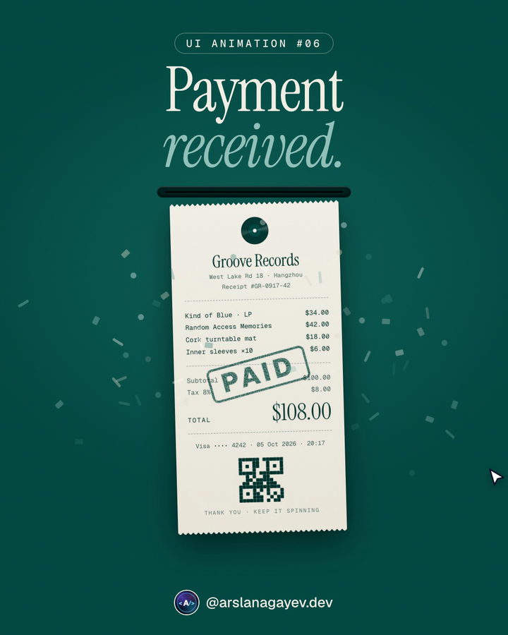

# Payment Receipt

Hold to pay: the button folds itself into a receipt printer, a thermal receipt feeds out in little steps while the total counts up and the QR code pops in, then the paper tears off, swings, gets a **PAID** stamp and confetti bursts out of the slot.



**[Live demo](https://arslanagayev.github.io/payment-receipt-animation/)** · **[Reel mode](https://arslanagayev.github.io/payment-receipt-animation/?reel)** · UI animation #06 of a weekly series on Instagram [@arslanagayev.dev](https://www.instagram.com/arslanagayev.dev/)

Plain **HTML, CSS and JavaScript**: no frameworks, no build step, no dependencies. Press and hold **Hold to pay** (mouse, touch, or Space/Enter), then click the receipt to start over.

## How it works

1. **Hold to pay.** A sweep fills the button while you hold; let go early and it drains back. Holding prevents accidental payments.
2. **Button to printer.** The button's `top`, `width`, `height`, `border-radius` and colour animate in one Web Animations call, so it folds up into a dark slot.
3. **Thermal printing.** The receipt hangs in a clip that starts at the slot's centre line, so it appears to come out of the slot. It feeds out in 18 quick eased steps with tiny pauses, like a real thermal printer, while the print head flickers, the vinyl logo spins, the total counts up and the QR modules pop in.
4. **Tear-off and stamp.** The clip lets go, the paper drops and swings on its top edge, a rubber stamp slams down (scale 2.6 → 0.92 → 1) and confetti tumbles out of the slot.

## Features

- Cyprus + Sand palette: deep green surfaces, warm thermal paper with grain and torn zigzag edges (CSS `mask` with `conic-gradient`)
- Rubber-stamp ink texture from an SVG noise mask, `mix-blend-mode: multiply` so it soaks into the paper
- Vinyl logo from a `repeating-radial-gradient`, generated QR pattern with real finder squares
- Fonts: Instrument Serif, Geist and Geist Mono
- Real `<button>` with keyboard hold support, `aria-live` status, `prefers-reduced-motion` support

## The key code

```js
// Thermal printer feed: quick eased steps, tiny pauses
function feedPaper(duration) {
  const steps = 18;
  const frames = [];
  for (let i = 0; i <= steps; i++) {
    const p = i / steps;
    frames.push({ translate: `0 ${-101 + 101 * p}%`, offset: p, easing: 'cubic-bezier(.2,.8,.2,1)' });
  }
  return wrap.animate(frames, { duration, fill: 'forwards' }).finished;
}
```

## Use it in your project

Copy `index.html`, `style.css` and `script.js`. The component itself has no dependencies; the `reel/` folder is only used by the reel mode described below. To drop it, delete the `mountReel(...)` call at the end of `script.js` and its import on the first line (keep `sleep`: `const sleep = (ms) => new Promise((r) => setTimeout(r, ms));`).

## Reel mode

Add `?reel` to the URL and the page becomes a self-playing 1080×1920 video stage: a title, the animation driven by a scripted cursor, a code excerpt and an end card, on a loop. `?autoplay` loops the scripted demo without the frame.

Options:

- `?reel&ratio=4x5`: a 1080×1350 stage for Instagram carousel videos
- `?reel&nocode`: hide the code excerpt
- `?reel&delay=3000`: wait 3 seconds before the first run (time to start the recorder)

## Run locally

ES modules don't load from `file://`, so serve the folder:

```bash
git clone https://github.com/arslanagayev/payment-receipt-animation.git
cd payment-receipt-animation
python3 -m http.server 8080   # then open http://localhost:8080
```

## Credits

Inspired by a payment-confirmation reel by [@iusmanshams](https://www.instagram.com/iusmanshams/); colours from the Cyprus + Sand combo by [@design.deb](https://www.instagram.com/design.deb/).

## License

[MIT](LICENSE) © 2026 Arslan Agayev
